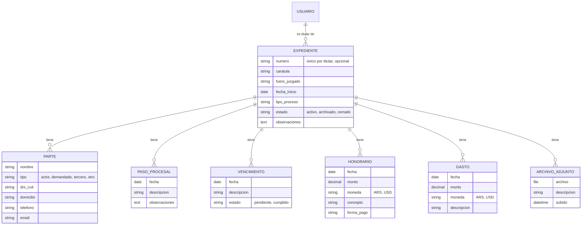

# Gestión Jurídica Web

Sistema web multiusuario para la gestión de expedientes de un estudio jurídico. Permite administrar causas, partes intervinientes, pasos procesales, vencimientos, honorarios, gastos y documentación adjunta. Se accede con usuario y contraseña, y los datos se almacenan de forma centralizada en la nube.

> Proyecto de práctica profesional — Teclab.

**Aplicación publicada:** https://gestion-juridica.onrender.com

## Demostración

La aplicación publicada tiene cargados dos usuarios de demostración, con **datos exclusivamente ficticios**:

| Usuario | Contraseña | Contenido |
|---|---|---|
| `ana.demo` | `demo-gestion-2026` | 12 expedientes con partes, pasos, vencimientos, honorarios y gastos |
| `beto.demo` | `demo-gestion-2026` | 4 expedientes |

Para comprobar el aislamiento entre usuarios: con la sesión de `beto.demo`, abrir la URL de un expediente de `ana.demo`. La aplicación responde "No encontramos lo que buscás".

> La aplicación usa planes gratuitos: si nadie la usó en los últimos minutos, **la primera visita puede tardar cerca de un minuto** en responder.
>
> Las contraseñas de demostración son públicas a propósito. Cualquier persona puede modificar esos datos, y se restauran ejecutando el comando `cargar_demo`.

## Descripción

En un estudio jurídico, la gestión de expedientes suele resolverse con herramientas dispersas: planillas, carpetas de archivos y programas de escritorio instalados en una sola máquina. Eso ata la información a un equipo, dificulta el trabajo desde distintos lugares y no ofrece garantías sobre el resguardo de datos sensibles.

Este proyecto propone una aplicación web centralizada, accesible desde cualquier dispositivo con navegador. Cada profesional inicia sesión y opera **únicamente sobre sus propios expedientes**, y la información se guarda en una base de datos en la nube.

## Características

- **Usuarios:** registro, inicio y cierre de sesión.
- **Pantalla inicial (dashboard):** el estado del trabajo de un vistazo.
  - Expedientes en trámite.
  - Vencimientos de hoy y de los próximos 7 días, con botón para marcarlos como cumplidos.
  - Aviso si hay vencimientos sin resolver con la fecha ya pasada.
  - Expedientes con movimiento en los últimos 30 días.
- **Expedientes:** alta, consulta, modificación y baja.
  - Número único por titular.
  - Búsqueda por texto y filtro por estado. Por defecto se muestran solo los activos.
  - Listado paginado, con los expedientes de actividad más reciente primero. Cualquier cambio en un expediente o en sus datos asociados actualiza su fecha de última actualización.
- **Entidades de cada expediente**, gestionadas desde su detalle:
  - **Partes** (actor, demandado, tercero).
  - **Pasos procesales**, con observaciones extensas (por ejemplo, el texto completo de un escrito), plegables en el detalle.
  - **Vencimientos**, que se marcan como cumplidos con un clic. Su estado se distingue por color: vencido, próximo (7 días), pendiente o cumplido.
  - **Honorarios y gastos**, con totales separados por moneda (pesos y dólares).
  - **Archivos adjuntos** (PDF, documentos e imágenes de hasta 5 MB), con descarga protegida.
- **Panel de vencimientos:** todos los plazos pendientes del usuario en una sola pantalla, ordenados por fecha, con los vencidos y los próximos resaltados.
- **Interfaz editorial y responsive**, inspirada en la diagramación de los diarios: títulos con serifa, secciones separadas por filetes, diseño plano. Se usa desde la computadora o el celular.
- **Modo claro y oscuro**, con un switch en el encabezado. La elección se recuerda en el navegador y funciona sin JavaScript.

## Seguridad

El sistema maneja información alcanzada por el secreto profesional, así que la seguridad es un requisito central:

- **Aislamiento de datos por usuario.**
  - Todas las consultas filtran por el titular del expediente. Las entidades asociadas lo alcanzan a través de su expediente.
  - El titular lo asigna siempre el servidor, nunca el formulario.
- **404 en lugar de 403** ante un recurso ajeno: no se revela si el recurso existe.
- **Descarga protegida de adjuntos.** Los archivos no tienen una URL pública: se sirven a través de una vista que exige sesión y verifica el titular.
- **Acciones que modifican datos solo por POST**, con protección CSRF. Esto incluye marcar como cumplido, cambiar el tema y cerrar sesión.
- **Sin redirecciones abiertas.** Cuando una acción vuelve a la página anterior, el destino se valida (o se elige de una lista fija) para que nunca lleve a un sitio externo.
- **En producción:**
  - HTTPS obligatorio, con HSTS.
  - Cookies de sesión y CSRF marcadas como seguras.
  - `DEBUG` desactivado y páginas de error propias.
- **Configuración sensible en variables de entorno.** La clave secreta y la conexión a la base nunca están en el código.

## Stack tecnológico

| Componente | Tecnología |
|---|---|
| Lenguaje | Python 3.13 |
| Framework | Django 5.2 LTS |
| Base de datos | SQLite (desarrollo y pruebas) / PostgreSQL en Neon (producción) |
| Interfaz | Plantillas de Django + Pico.css, sin JavaScript; tipografías Newsreader y Libre Franklin |
| Servidor de producción | Gunicorn |
| Archivos estáticos | WhiteNoise |
| Despliegue | Render |

## Modelo de datos



Al eliminar un expediente se eliminan también sus entidades asociadas y los archivos adjuntos del disco.

## Estructura del proyecto

```
gestion-juridica-web/
├── gestion_juridica/          # Configuración del proyecto (settings, urls, wsgi)
│   ├── views.py               # Registro de usuarios y cambio de tema (claro/oscuro)
│   └── context_processors.py  # Pone el tema elegido a disposición de todas las plantillas
├── expedientes/               # Aplicación principal
│   ├── models.py              # Modelos de datos
│   ├── views.py               # Vistas (basadas en clases)
│   ├── forms.py               # Formularios y validaciones
│   ├── urls.py                # Rutas
│   ├── tests.py               # Pruebas automáticas
│   ├── management/commands/
│   │   └── cargar_demo.py     # Comando de datos de demostración
│   └── static/expedientes/    # CSS, tipografías y logo
├── templates/                 # Plantillas HTML (incluye 404 y 500 propias)
├── docs/
│   └── pruebas.md             # Informe de pruebas
├── requirements.txt           # Dependencias con versión fija
├── .python-version            # Versión de Python usada en producción
└── .env.example               # Plantilla de variables de entorno
```

## Instalación y uso local

Requisitos: **Python 3.13** y Git.

```bash
# Clonar el repositorio
git clone https://github.com/joaquintomasrana/gestion-juridica-web.git
cd gestion-juridica-web

# Crear y activar un entorno virtual
python -m venv .venv
# Windows (PowerShell):
.\.venv\Scripts\Activate.ps1
# Linux / macOS:
# source .venv/bin/activate

# Instalar las dependencias
pip install -r requirements.txt

# Crear el archivo .env a partir de la plantilla
cp .env.example .env
# Windows (PowerShell):
# Copy-Item .env.example .env

# Generar una clave secreta y pegarla en el .env como valor de SECRET_KEY
python -c "from django.core.management.utils import get_random_secret_key; print(get_random_secret_key())"

# Crear las tablas
python manage.py migrate

# (Opcional) Cargar los datos de demostración: usuarios ana.demo y beto.demo
python manage.py cargar_demo

# (Opcional) Crear un usuario administrador
python manage.py createsuperuser

# Levantar el servidor de desarrollo
python manage.py runserver
```

Después, abrir http://127.0.0.1:8000/ en el navegador.

### Variables de entorno

| Variable | Uso | En desarrollo | En producción |
|---|---|---|---|
| `SECRET_KEY` | Clave para firmar sesiones y tokens | Obligatoria (en el `.env`) | Obligatoria, distinta de la de desarrollo |
| `DEBUG` | Modo de depuración | `True` | No se define (queda en `False`) |
| `ALLOWED_HOSTS` | Dominios permitidos | `127.0.0.1,localhost` | No hace falta: se toma de `RENDER_EXTERNAL_HOSTNAME` |
| `DATABASE_URL` | Conexión a PostgreSQL | No se define: se usa SQLite | Cadena de conexión de Neon |

## Pruebas

```bash
python manage.py test expedientes
```

La suite tiene **79 pruebas automáticas**. Cubren:

- el aislamiento entre usuarios, tanto en consultas como en modificaciones;
- las validaciones;
- los archivos adjuntos y su descarga protegida;
- el dashboard y el panel de vencimientos, incluida la cantidad de consultas a la base;
- la fecha de última actualización de los expedientes;
- el modo oscuro, incluida la validación del destino de regreso;
- la interfaz.

Su eficacia se verificó introduciendo fallas a propósito en el código y comprobando que las pruebas las detectaran.

El detalle está en [`docs/pruebas.md`](docs/pruebas.md). Incluye las pruebas de seguridad realizadas sobre la aplicación publicada y el recorrido funcional manual.

## Despliegue

La aplicación corre en **Render** (servicio web) con la base de datos en **Neon** (PostgreSQL), los dos en la región de Virginia (EE. UU.).

| Configuración en Render | Valor |
|---|---|
| Build Command | `pip install -r requirements.txt && python manage.py collectstatic --no-input && python manage.py migrate` |
| Start Command | `gunicorn gestion_juridica.wsgi:application` |
| Variables de entorno | `SECRET_KEY`, `DATABASE_URL` |

Cada `push` a la rama `main` dispara un despliegue automático.

El mismo código funciona en desarrollo y en producción: la configuración cambia según las variables de entorno. Los ajustes de HTTPS y el almacenamiento comprimido de archivos estáticos se activan solo cuando la aplicación corre en Render.

## Limitaciones conocidas

1. **Planes gratuitos.** El servidor y la base de datos se suspenden tras un período sin uso, y la primera visita posterior demora cerca de un minuto.
2. **Archivos adjuntos no persistentes en producción.** El disco de Render es efímero: los adjuntos se pierden en cada redespliegue o reinicio. Para un uso real se recomienda un almacenamiento de objetos externo (por ejemplo, Cloudflare R2 o Amazon S3); la vista de descarga protegida no requeriría cambios.
3. **Un titular por expediente.** Cada usuario trabaja de forma aislada; los expedientes no se comparten entre profesionales de un mismo estudio.

## Trabajo futuro

Para un uso real en un estudio jurídico:

- Estudios con varios profesionales y roles, con expedientes compartidos.
- Almacenamiento persistente y privado para los adjuntos.
- Copias de seguridad automáticas y probadas.
- Recuperación de contraseña por email, verificación en dos pasos y bloqueo ante intentos fallidos.
- Registro de auditoría: quién consultó o modificó cada expediente.
- Revisión de los requisitos de la Ley 25.326 de protección de datos personales, en particular sobre la transferencia internacional de datos.

## Uso de datos

Se trata de un proyecto académico, y se utiliza **exclusivamente con datos ficticios**. No contiene, ni está destinado a contener, información real de clientes.

## Autor

Joaquín Raña
